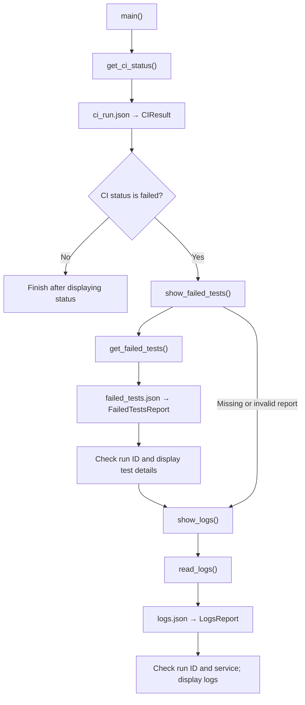
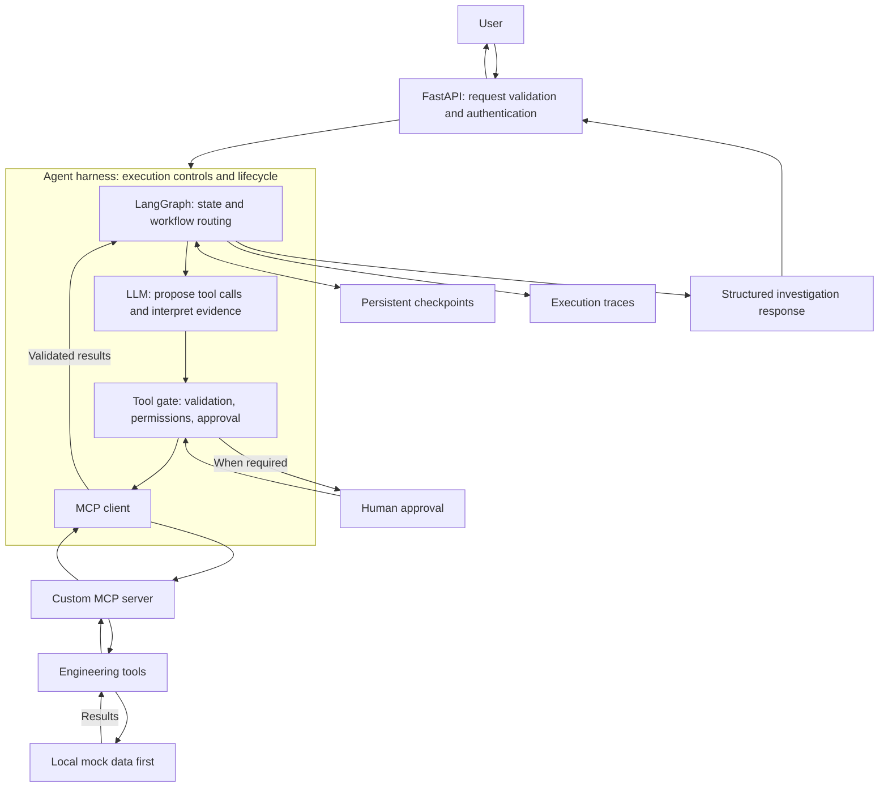

# AI Engineering Operations Agent

An engineering project for learning how to build reliable, stateful agents that investigate CI and deployment failures.

Development starts with local mock data. The current implementation is a deterministic Python workflow; LLM integration, LangGraph, and MCP are planned.

## Current capabilities

- Load CI status from a local JSON report.
- Validate reports using Pydantic.
- Retrieve failed-test details when CI reports a failure.
- Check that CI status and failed-test reports refer to the same run.
- Handle missing files, invalid data, and empty failed-test lists.
- Test model validation, file loading, and application behavior.

## Example

Given a failed CI report and matching failed-test details, the application displays:

```text
Service: backend
CI run: 42
Status: failed
- test_health_endpoint: Expected HTTP 200, received HTTP 503.
```

These are fictional development fixtures. The output reports available evidence; it does not establish the root cause.

## Architecture

### Current implementation

The application is a deterministic Python workflow using local mock data.



The diagram summarizes the normal flow and the missing/invalid
failed-test case. Other handled cases include mismatched reports and
empty lists.

Each tool reads JSON and validates it with Pydantic before returning a
typed object. The display functions handle expected errors and check
whether the evidence belongs to the investigation.

The two evidence steps run sequentially. A handled problem in the
failed-test step does not prevent the log step from running.

### Code responsibilities

| Component | Responsibility |
|---|---|
| `models.py` | Define and validate report structures |
| `tools.py` | Read local reports and return validated objects |
| `main.py` | Coordinate calls, handle expected errors, check evidence identity, and display results |
| `data/` | Store fictional engineering reports |
| `tests/` | Verify model, tool, and application behavior |

### Target architecture — planned



This target architecture is not implemented yet.

### Target responsibilities

| Component | Planned responsibility |
|---|---|
| FastAPI | Receive requests, validate API inputs, identify callers, and expose investigation results |
| Agent harness | Coordinate execution limits, permissions, approval, timeouts, retries, and failure handling |
| LangGraph | Execute workflow nodes, route between steps, and update investigation state |
| LLM | Propose actions and interpret evidence within the controls enforced by code |
| MCP client | Discover and invoke tools exposed by the MCP server |
| MCP server | Expose engineering tools through MCP and enforce server-side validation and access controls |
| Engineering tools | Retrieve evidence or perform explicitly permitted actions |
| Checkpoint storage | Persist workflow state for recovery and resumption |
| Tracing | Record execution steps, tool calls, errors, and timing |
| Evaluation suite | Run defined scenarios and measure investigation quality and control behavior |

### Key design principles

- Validate tool inputs and outputs.
- Check that evidence belongs to the correct investigation.
- Distinguish unavailable evidence from a reported engineering failure.
- Continue collecting other evidence after a handled source failure.
- Require approval for designated write actions.
- Treat tool-provided text as evidence, not as instructions.
- Report uncertainty rather than inventing a root cause.

LangGraph supplies workflow capabilities. The complete harness also
requires application-specific policies, integrations, and operational
controls. MCP supplies a tool communication protocol; it does not decide
which actions are appropriate.
## Requirements

- Python 3.12 — currently tested with Python 3.12.8
- Dependencies declared in `requirements.txt`

The commands below use Windows PowerShell.

## Setup

```powershell
git clone https://github.com/oumas3/ai-engineering-ops-agent.git
cd ai-engineering-ops-agent

py -3.12 -m venv .venv
.\.venv\Scripts\python.exe -m pip install -r requirements.txt
```

## Run

From the project root:

```powershell
$env:PYTHONPATH = "src"
.\.venv\Scripts\python.exe -m ops_agent.main
```

The current application reads:

- `data/ci_run.json`
- `data/failed_tests.json` when CI status is `failed`

Paths are relative to the current working directory.

## Tests

```powershell
.\.venv\Scripts\python.exe -m pytest -q --basetemp=.\.pytest-tmp-01
```

The temporary directory is dedicated to pytest and excluded from Git.
Pytest clears it when reusing it; do not store other files there.

At the latest local verification, all 10 tests passed.

## Project structure

| Path | Purpose |
|---|---|
| `src/ops_agent/models.py` | Pydantic data contracts |
| `src/ops_agent/tools.py` | Local report-loading functions |
| `src/ops_agent/main.py` | Application flow and error handling |
| `data/` | Mock CI and failed-test reports |
| `tests/` | Automated tests |
| `requirements.txt` | Dependency declarations |
| `pytest.ini` | Pytest configuration |

## Design decisions

### Validate data at the boundary

Tools validate JSON before returning typed objects. Invalid data raises
`ValidationError`; missing files raise `FileNotFoundError`.

### Separate tool behavior from user-facing output

Tools load and validate reports. The application entry point catches
expected errors and displays results.

### Check evidence belongs to the same run

Individually valid reports can describe different CI runs. The application
compares run IDs before displaying failed-test details.

### Distinguish failure from missing evidence

A valid status of `failed` reports a CI failure. A missing report means
the application could not obtain the evidence. These are different cases.

## Progress

- [x] Task 1: CI status retrieval, validati# AI Engineering Operations Agent

An engineering project for learning how to build reliable, stateful agents that investigate CI and deployment failures.

Development starts with local mock data. The current implementation is a deterministic Python workflow; LLM integration, LangGraph, and MCP are planned.

## Current capabilities

- Load CI status from a local JSON report.
- Validate reports using Pydantic.
- Retrieve failed-test details when CI reports a failure.
- Check that CI status and failed-test reports refer to the same run.
- Handle missing files, invalid data, and empty failed-test lists.
- Test model validation, file loading, and application behavior.

## Example

Given a failed CI report and matching failed-test details, the application displays:

```text
Service: backend
CI run: 42
Status: failed
- test_health_endpoint: Expected HTTP 200, received HTTP 503.
```

These are fictional development fixtures. The output reports available evidence; it does not establish the root cause.

## Requirements

- Python 3.12 — currently tested with Python 3.12.8
- Dependencies declared in `requirements.txt`

The commands below use Windows PowerShell.

## Setup

```powershell
git clone https://github.com/oumas3/ai-engineering-ops-agent.git
cd ai-engineering-ops-agent

py -3.12 -m venv .venv
.\.venv\Scripts\python.exe -m pip install -r requirements.txt
```

## Run

From the project root:

```powershell
$env:PYTHONPATH = "src"
.\.venv\Scripts\python.exe -m ops_agent.main
```

The current application reads:

- `data/ci_run.json`
- `data/failed_tests.json` when CI status is `failed`

Paths are relative to the current working directory.

## Tests

```powershell
.\.venv\Scripts\python.exe -m pytest -q --basetemp=.\.pytest-tmp-01
```

The temporary directory is dedicated to pytest and excluded from Git.
Pytest clears it when reusing it; do not store other files there.

At the latest local verification, all 10 tests passed.

## Project structure

| Path | Purpose |
|---|---|
| `src/ops_agent/models.py` | Pydantic data contracts |
| `src/ops_agent/tools.py` | Local report-loading functions |
| `src/ops_agent/main.py` | Application flow and error handling |
| `data/` | Mock CI and failed-test reports |
| `tests/` | Automated tests |
| `requirements.txt` | Dependency declarations |
| `pytest.ini` | Pytest configuration |

## Design decisions

### Validate data at the boundary

Tools validate JSON before returning typed objects. Invalid data raises
`ValidationError`; missing files raise `FileNotFoundError`.

### Separate tool behavior from user-facing output

Tools load and validate reports. The application entry point catches
expected errors and displays results.

### Check evidence belongs to the same run

Individually valid reports can describe different CI runs. The application
compares run IDs before displaying failed-test details.

### Distinguish failure from missing evidence

A valid status of `failed` reports a CI failure. A missing report means
the application could not obtain the evidence. These are different cases.

## Project status and roadmap

The project currently runs a stateful engineering investigation against
mock reports or evidence collected from a real local Docker environment.

LangGraph controls evidence collection through a custom MCP server.
An optional Groq analysis step produces structured observations,
hypotheses, recommended checks, and limitations. Issue creation requires
permission and human approval.

### Completed milestones

- [x] **Part 1 — Project foundation and CI reports**
  - Python environment, modular structure, and pytest.
  - Pydantic validation for CI reports.
  - Handling missing files and invalid report data.

- [x] **Part 2 — Failed-test evidence**
  - Retrieve and validate failed-test reports.
  - Match report run IDs to the investigated CI run.
  - Distinguish missing reports from reports with no failed tests.

- [x] **Part 3 — Log collection**
  - Read structured logs.
  - Validate service and CI run identity.
  - Preserve useful evidence when another report is unavailable.

- [x] **Part 4 — Service health**
  - Collect and validate service-status reports.
  - Match service and environment before accepting evidence.

- [x] **Part 5 — Custom MCP server and client**
  - Expose CI, failed-test, log, and service-status tools.
  - Discover and execute tools through an MCP client.
  - Validate structured tool responses.

- [x] **Part 6 — Stateful LangGraph investigation**
  - Implement collection nodes and conditional routing.
  - Store accepted evidence and collection errors in graph state.
  - Test routing and graph execution.

- [x] **Part 7 — Timeouts and retries**
  - Apply configurable deadlines to read-tool requests.
  - Retry timed-out reads with a bounded number of attempts.
  - Record handled failures in investigation state.

- [x] **Part 8 — Persistent investigations**
  - Store checkpoints in SQLite.
  - Inspect saved investigations without rerunning inference.
  - Pause and resume unfinished workflows.
  - Configure serialization for custom Pydantic models.

- [x] **Part 9 — Permissions, approval, and local issue creation**
  - Prepare an issue proposal from collected evidence.
  - Require explicit permission and human approval before writing.
  - Create local issue records.
  - Use request IDs to prevent duplicate writes for repeated requests.

- [x] **Part 10 — Real local engineering evidence**
  - Run a FastAPI demo backend and PostgreSQL with Docker Compose.
  - Exercise the backend readiness endpoint with integration tests.
  - Convert pytest XML and container logs into validated reports.
  - Probe service readiness and investigate a selected report run.

- [x] **Part 11 — Structured LLM analysis**
  - Integrate Groq through an asynchronous client.
  - Build model input from collected investigation state.
  - Validate structured analysis with Pydantic.
  - Bound analysis execution with a timeout.
  - Preserve evidence and produce a proposal when analysis fails.
  - Label hypotheses as unverified and checks as not performed.
  - Persist analysis alongside the investigation checkpoint.
  - Test the integration using mocked model responses.

### Remaining milestones

- [ ] **Part 12 — Async FastAPI interface**
  - Start investigations through HTTP.
  - Retrieve investigation status, evidence, and proposals.
  - Submit approval or rejection decisions.
  - Manage MCP, model-client, and database lifecycles.
  - Handle concurrent requests and test API behavior.

- [ ] **Part 12B — Minimal browser interface**
  - Provide a form to start an investigation.
  - Display progress, evidence, analysis, and collection errors.
  - Present the exact issue proposal for approval or rejection.
  - Keep permission enforcement in the backend.

- [ ] **Part 13 — Agent harness and advanced workflows**
  - Add bounded model-driven selection of permitted read tools.
  - Validate tool arguments and enforce execution budgets.
  - Develop routing, retry, and fallback policies.
  - Extend MCP capabilities where needed.
  - Preserve approval requirements for write actions.

- [ ] **Part 14 — Tracing and observability**
  - Correlate investigations, node executions, and tool calls.
  - Record latency, failures, model usage, and retry attempts.
  - Make failed or slow investigations easier to diagnose.

- [ ] **Part 15 — Agent evaluation**
  - Build repeatable investigation scenarios.
  - Evaluate evidence grounding and unsupported claims.
  - Measure task completion and permission compliance.
  - Compare prompts and models using recorded results.

- [ ] **Part 16 — Packaging, CI, and reproducible demo**
  - Containerize the agent and its API.
  - Automate tests and project checks in CI.
  - Document configuration, architecture, and execution.
  - Provide a reproducible end-to-end demonstration.
## FastAPI runtime

The investigation workflow can also run as a local FastAPI service.

Install dependencies:

```powershell
python -m pip install -r requirements.txt
### Optional extensions

- [ ] Connect real engineering services, such as GitHub, through MCP.
- [ ] Extend issue operations beyond local storage.
- [ ] Compare additional model providers.

## Current validation and limitations

The latest local unit and integration test suite completed with
**62 passing tests**. The Docker-dependent backend checks are run separately.

Manual checks also confirmed that an investigation can generate structured
analysis, include it in a proposal, and restore it from a SQLite checkpoint.

These checks verify implemented behavior; they do not establish diagnostic
accuracy or production reliability.

- Evidence collection currently follows a predefined graph.
  Model-driven tool selection is planned.
- Pydantic validates structure and types, not factual correctness.
- Model hypotheses may be unsupported or incorrect and require review.
- Automated detection of reasoning contradictions is not implemented yet.
- Recommended checks are suggestions, not automatically executed actions.
- Issue creation currently writes local JSON records.
- The agent API, browser interface, tracing, and systematic evaluation
  remain planned work.

Tests are added alongside implementation. Work is completed and committed
in small increments.

## Current limitations

- Uses local mock files, with no external service integrations.
- Does not yet use an LLM, LangGraph, or MCP.
- Does not diagnose root causes or recommend remediation.
- Handles missing files and validation errors, but not every possible I/O error.
- Dependency ranges are declared; an exact dependency lock is not yet included.
