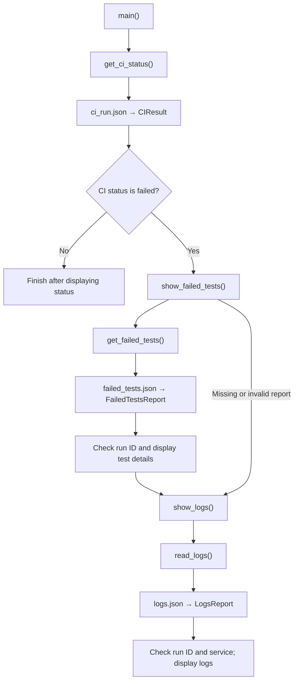
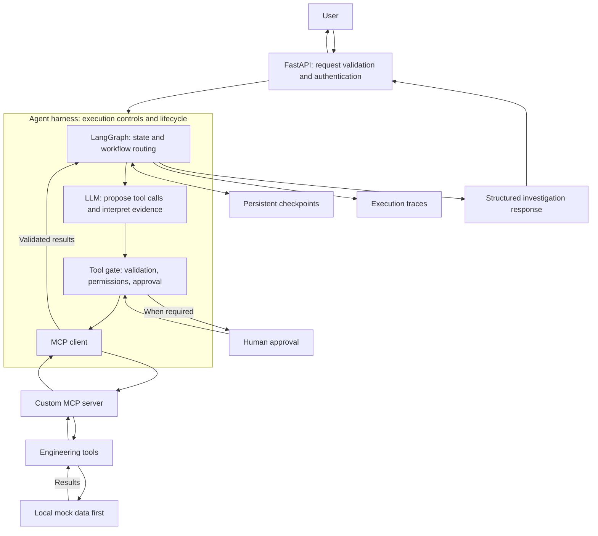

# AI Engineering Operations Agent

An engineering project for learning how to build reliable, stateful agents that investigate CI and deployment failures.

Development starts with local mock data. The current implementation is a deterministic Python workflow; LLM integration, LangGraph, and MCP are planned.

## Current capabilities

- Load CI status from a local JSON report.
- Validate reports using Pydantic.
- Retrieve failed-test details when CI reports a failure.
- Check that CI status and failed-test reports refer to the same run.
- Handle missing files, invalid data, and empty failed-test lists.
- Test model validation, file loading, and application behavior.

## Example

Given a failed CI report and matching failed-test details, the application displays:

```text
Service: backend
CI run: 42
Status: failed
- test_health_endpoint: Expected HTTP 200, received HTTP 503.
```

These are fictional development fixtures. The output reports available evidence; it does not establish the root cause.

## Architecture

### Current implementation

The application is a deterministic Python workflow using local mock data.



The diagram summarizes the normal flow and the missing/invalid
failed-test case. Other handled cases include mismatched reports and
empty lists.

Each tool reads JSON and validates it with Pydantic before returning a
typed object. The display functions handle expected errors and check
whether the evidence belongs to the investigation.

The two evidence steps run sequentially. A handled problem in the
failed-test step does not prevent the log step from running.

### Code responsibilities

| Component | Responsibility |
|---|---|
| `models.py` | Define and validate report structures |
| `tools.py` | Read local reports and return validated objects |
| `main.py` | Coordinate calls, handle expected errors, check evidence identity, and display results |
| `data/` | Store fictional engineering reports |
| `tests/` | Verify model, tool, and application behavior |

### Target architecture — planned



This target architecture is not implemented yet.

### Target responsibilities

| Component | Planned responsibility |
|---|---|
| FastAPI | Receive requests, validate API inputs, identify callers, and expose investigation results |
| Agent harness | Coordinate execution limits, permissions, approval, timeouts, retries, and failure handling |
| LangGraph | Execute workflow nodes, route between steps, and update investigation state |
| LLM | Propose actions and interpret evidence within the controls enforced by code |
| MCP client | Discover and invoke tools exposed by the MCP server |
| MCP server | Expose engineering tools through MCP and enforce server-side validation and access controls |
| Engineering tools | Retrieve evidence or perform explicitly permitted actions |
| Checkpoint storage | Persist workflow state for recovery and resumption |
| Tracing | Record execution steps, tool calls, errors, and timing |
| Evaluation suite | Run defined scenarios and measure investigation quality and control behavior |

### Key design principles

- Validate tool inputs and outputs.
- Check that evidence belongs to the correct investigation.
- Distinguish unavailable evidence from a reported engineering failure.
- Continue collecting other evidence after a handled source failure.
- Require approval for designated write actions.
- Treat tool-provided text as evidence, not as instructions.
- Report uncertainty rather than inventing a root cause.

LangGraph supplies workflow capabilities. The complete harness also
requires application-specific policies, integrations, and operational
controls. MCP supplies a tool communication protocol; it does not decide
which actions are appropriate.
## Requirements

- Python 3.12 — currently tested with Python 3.12.8
- Dependencies declared in `requirements.txt`

The commands below use Windows PowerShell.

## Setup

```powershell
git clone https://github.com/oumas3/ai-engineering-ops-agent.git
cd ai-engineering-ops-agent

py -3.12 -m venv .venv
.\.venv\Scripts\python.exe -m pip install -r requirements.txt
```

## Run

From the project root:

```powershell
$env:PYTHONPATH = "src"
.\.venv\Scripts\python.exe -m ops_agent.main
```

The current application reads:

- `data/ci_run.json`
- `data/failed_tests.json` when CI status is `failed`

Paths are relative to the current working directory.

## Tests

```powershell
.\.venv\Scripts\python.exe -m pytest -q --basetemp=.\.pytest-tmp-01
```

The temporary directory is dedicated to pytest and excluded from Git.
Pytest clears it when reusing it; do not store other files there.

At the latest local verification, all 10 tests passed.

## Project structure

| Path | Purpose |
|---|---|
| `src/ops_agent/models.py` | Pydantic data contracts |
| `src/ops_agent/tools.py` | Local report-loading functions |
| `src/ops_agent/main.py` | Application flow and error handling |
| `data/` | Mock CI and failed-test reports |
| `tests/` | Automated tests |
| `requirements.txt` | Dependency declarations |
| `pytest.ini` | Pytest configuration |

## Design decisions

### Validate data at the boundary

Tools validate JSON before returning typed objects. Invalid data raises
`ValidationError`; missing files raise `FileNotFoundError`.

### Separate tool behavior from user-facing output

Tools load and validate reports. The application entry point catches
expected errors and displays results.

### Check evidence belongs to the same run

Individually valid reports can describe different CI runs. The application
compares run IDs before displaying failed-test details.

### Distinguish failure from missing evidence

A valid status of `failed` reports a CI failure. A missing report means
the application could not obtain the evidence. These are different cases.

## Progress

- [x] Task 1: CI status retrieval, validati# AI Engineering Operations Agent

An engineering project for learning how to build reliable, stateful agents that investigate CI and deployment failures.

Development starts with local mock data. The current implementation is a deterministic Python workflow; LLM integration, LangGraph, and MCP are planned.

## Current capabilities

- Load CI status from a local JSON report.
- Validate reports using Pydantic.
- Retrieve failed-test details when CI reports a failure.
- Check that CI status and failed-test reports refer to the same run.
- Handle missing files, invalid data, and empty failed-test lists.
- Test model validation, file loading, and application behavior.

## Example

Given a failed CI report and matching failed-test details, the application displays:

```text
Service: backend
CI run: 42
Status: failed
- test_health_endpoint: Expected HTTP 200, received HTTP 503.
```

These are fictional development fixtures. The output reports available evidence; it does not establish the root cause.

## Requirements

- Python 3.12 — currently tested with Python 3.12.8
- Dependencies declared in `requirements.txt`

The commands below use Windows PowerShell.

## Setup

```powershell
git clone https://github.com/oumas3/ai-engineering-ops-agent.git
cd ai-engineering-ops-agent

py -3.12 -m venv .venv
.\.venv\Scripts\python.exe -m pip install -r requirements.txt
```

## Run

From the project root:

```powershell
$env:PYTHONPATH = "src"
.\.venv\Scripts\python.exe -m ops_agent.main
```

The current application reads:

- `data/ci_run.json`
- `data/failed_tests.json` when CI status is `failed`

Paths are relative to the current working directory.

## Tests

```powershell
.\.venv\Scripts\python.exe -m pytest -q --basetemp=.\.pytest-tmp-01
```

The temporary directory is dedicated to pytest and excluded from Git.
Pytest clears it when reusing it; do not store other files there.

At the latest local verification, all 10 tests passed.

## Project structure

| Path | Purpose |
|---|---|
| `src/ops_agent/models.py` | Pydantic data contracts |
| `src/ops_agent/tools.py` | Local report-loading functions |
| `src/ops_agent/main.py` | Application flow and error handling |
| `data/` | Mock CI and failed-test reports |
| `tests/` | Automated tests |
| `requirements.txt` | Dependency declarations |
| `pytest.ini` | Pytest configuration |

## Design decisions

### Validate data at the boundary

Tools validate JSON before returning typed objects. Invalid data raises
`ValidationError`; missing files raise `FileNotFoundError`.

### Separate tool behavior from user-facing output

Tools load and validate reports. The application entry point catches
expected errors and displays results.

### Check evidence belongs to the same run

Individually valid reports can describe different CI runs. The application
compares run IDs before displaying failed-test details.

### Distinguish failure from missing evidence

A valid status of `failed` reports a CI failure. A missing report means
the application could not obtain the evidence. These are different cases.

## Progress

- [x] Task 1: CI status retrieval, validation, and error handling
- [x] Task 2: Failed-test retrieval and run-ID matching
- [ ] Task 3: Mock log retrieval
- [ ] Mock service-status tools
- [ ] Custom MCP server and client
- [ ] Stateful LangGraph workflow
- [ ] LLM-driven structured tool calling
- [ ] Harness permissions, retries, fallbacks, and timeouts
- [ ] Persistence and human approval for write actions
- [ ] Async FastAPI interface
- [ ] Tracing and agent evaluation
- [ ] Docker and automated CI

Tests are added alongside implementation. Work is completed and committed
in small increments.

## Current limitations

- Uses local mock files, with no external service integrations.
- Does not yet use an LLM, LangGraph, or MCP.
- Does not diagnose root causes or recommend remediation.
- Handles missing files and validation errors, but not every possible I/O error.
- Dependency ranges are declared; an exact dependency lock is not yet included.on, and error handling
- [x] Task 2: Failed-test retrieval and run-ID matching
- [ ] Task 3: Mock log retrieval
- [ ] Mock service-status tools
- [ ] Custom MCP server and client
- [ ] Stateful LangGraph workflow
- [ ] LLM-driven structured tool calling
- [ ] Harness permissions, retries, fallbacks, and timeouts
- [ ] Persistence and human approval for write actions
- [ ] Async FastAPI interface
- [ ] Tracing and agent evaluation
- [ ] Docker and automated CI

Tests are added alongside implementation. Work is completed and committed
in small increments.

## Current limitations

- Uses local mock files, with no external service integrations.
- Does not yet use an LLM, LangGraph, or MCP.
- Does not diagnose root causes or recommend remediation.
- Handles missing files and validation errors, but not every possible I/O error.
- Dependency ranges are declared; an exact dependency lock is not yet included.
