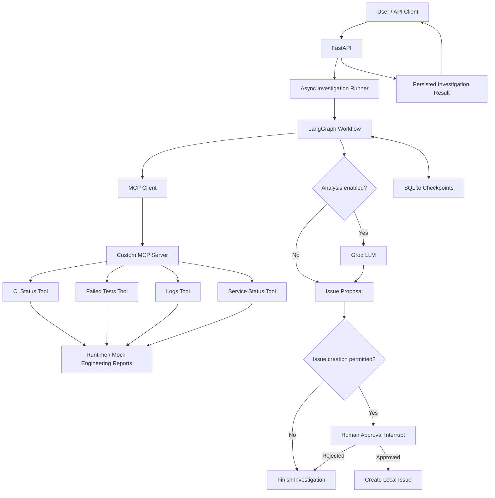

# AI Engineering Operations Agent

A stateful engineering operations agent for investigating CI and deployment failures using structured evidence, LangGraph workflows, MCP tools, persistent checkpoints, optional LLM analysis, and human approval for write actions.

The project is built incrementally around reliability and control rather than autonomous action. It starts from reproducible local engineering evidence and gradually introduces agentic capabilities while keeping validation, permissions, and human review explicit.

## Current capabilities

The agent can:

- Start investigations from stored engineering report runs.
- Retrieve and validate CI status with Pydantic.
- Collect failed-test evidence for failed CI runs.
- Read structured application logs.
- Retrieve service-health information.
- Check that evidence belongs to the same CI run, service, and environment.
- Continue collecting useful evidence when another source is unavailable.
- Expose engineering tools through a custom MCP server.
- Execute investigations through a stateful LangGraph workflow.
- Retry bounded read-tool timeouts.
- Persist investigation state in SQLite.
- Resume interrupted investigations from checkpoints.
- Optionally analyse evidence using Groq.
- Store structured observations, hypotheses, recommended checks, and limitations.
- Generate an issue proposal from collected evidence.
- Require explicit permission and human approval before issue creation.
- Accept approval or rejection through FastAPI.
- Create approved issue records locally.
- Prevent duplicate issue writes using request IDs.
- Start investigations asynchronously through HTTP.
- Retrieve persisted investigation results through HTTP.
- Serialize large CI identifiers safely for browser and JavaScript clients.
- Expose interactive API documentation through FastAPI Swagger.

## Architecture



## Core design principles

### Validate at boundaries

External and stored evidence is validated using Pydantic before being accepted into investigation state.

### Keep evidence tied to the investigation

CI reports, failed tests, logs, and service status are checked for matching run, service, and environment identifiers.

### Preserve partial evidence

A missing or failed evidence source should not automatically discard evidence successfully collected elsewhere.

### Separate evidence from conclusions

Logs and reports are treated as evidence.

Model-generated hypotheses are explicitly labelled as unverified and do not become established root causes automatically.

### Human approval for write actions

The agent can prepare an issue proposal automatically, but issue creation requires:

1. write permission,
2. a persisted proposal,
3. explicit human approval.

### Persist before acting

LangGraph checkpoints are stored in SQLite so interrupted investigations can be inspected and resumed safely.

## Project structure

| Path | Purpose |
|---|---|
| `src/ops_agent/models.py` | Core Pydantic domain models |
| `src/ops_agent/state.py` | LangGraph investigation state |
| `src/ops_agent/tools.py` | Local engineering tools and issue creation |
| `src/ops_agent/mcp_server.py` | Custom MCP server |
| `src/ops_agent/nodes.py` | Evidence, analysis, approval, and action nodes |
| `src/ops_agent/workflow.py` | LangGraph workflow construction and routing |
| `src/ops_agent/persistence.py` | Checkpoint serialization |
| `src/ops_agent/api.py` | FastAPI application |
| `src/ops_agent/api_models.py` | API request and response models |
| `src/ops_agent/api_runner.py` | Asynchronous investigation queue |
| `src/ops_agent/api_executor.py` | Investigation execution lifecycle |
| `src/ops_agent/api_reader.py` | Persisted investigation retrieval |
| `src/ops_agent/api_decisions.py` | Approval/rejection resume logic |
| `runtime/runs/` | Generated engineering report runs |
| `runtime/issues/` | Approved local issue records |
| `runtime/checkpoints.sqlite` | Persisted LangGraph checkpoints |
| `services/backend/` | Local backend used for engineering-failure scenarios |
| `tests/` | Automated unit and integration tests |
| `requirements.txt` | Python dependencies |

## Requirements

- Python 3.12
- Dependencies declared in `requirements.txt`

Main runtime dependencies include:

- FastAPI
- Uvicorn
- Pydantic
- MCP
- LangGraph
- SQLite checkpoint support
- Groq
- HTTPX
- pytest

## Setup

The examples below use Windows PowerShell.

```powershell
git clone https://github.com/oumas3/ai-engineering-ops-agent.git
cd ai-engineering-ops-agent

py -3.12 -m venv .venv
.\.venv\Scripts\Activate.ps1

python -m pip install -r requirements.txt
```

Set the source directory:

```powershell
$env:PYTHONPATH = "src"
```

## Run the FastAPI service

Start the API with:

```powershell
$env:PYTHONPATH = "src"
python -m uvicorn ops_agent.api:create_app --factory --reload
```

Open the interactive API documentation:

```text
http://127.0.0.1:8000/docs
```

### API endpoints

#### Start an investigation

```http
POST /investigations
```

Example request:

```json
{
  "report_run": "8446db8b15b44d6faf077f7d31dc0ac2",
  "analyse": false
}
```

Example response:

```json
{
  "investigation_id": "df091d92-2473-4135-9bfe-d0c89881a648"
}
```

The API returns HTTP `202 Accepted` because the investigation runs asynchronously.

#### Retrieve an investigation

```http
GET /investigations/{investigation_id}
```

The response can include:

- CI status,
- failed tests,
- logs,
- service health,
- structured model analysis,
- issue proposal,
- collection errors.

Large CI run identifiers are serialized as strings at the API boundary so browsers and JavaScript clients do not lose integer precision.

#### Submit a human decision

```http
POST /investigations/{investigation_id}/decision
```

Example:

```json
{
  "decision": "approved"
}
```

or:

```json
{
  "decision": "rejected"
}
```

Successful decisions return:

```text
204 No Content
```

## Human approval and issue creation

Issue creation is disabled by default.

To enable the approval path:

```powershell
$env:OPS_ALLOW_CREATE_ISSUE = "1"
$env:PYTHONPATH = "src"

python -m uvicorn ops_agent.api:create_app --factory --reload
```

For a failed CI investigation, the workflow becomes:

```text
CI failure
    ↓
failed tests
    ↓
logs
    ↓
service health
    ↓
optional model analysis
    ↓
issue proposal
    ↓
human approval
   ↙       ↘
reject    approve
  ↓          ↓
finish   create issue
```

Approved issue records are written to:

```text
runtime/issues/
```

Issue creation is currently local and intentionally controlled.

## Optional LLM analysis

An investigation can request structured analysis using:

```json
{
  "analyse": true
}
```

The model produces:

- observations,
- hypotheses,
- recommended checks,
- limitations.

Model hypotheses remain unverified.

Recommended checks are suggestions and are not automatically executed.

If analysis fails or times out, the investigation preserves collected engineering evidence and can still generate an issue proposal.

## Persistence

Investigations use LangGraph checkpoints stored in:

```text
runtime/checkpoints.sqlite
```

Each investigation uses its UUID as the LangGraph thread ID.

Persistence allows the API to:

- retrieve previous investigation state,
- inspect collected evidence,
- detect pending approval interrupts,
- resume a paused workflow after approval or rejection.

## Tests

Run the complete test suite with:

```powershell
python -m pytest -q --basetemp=.\.pytest-tmp-01
```

Latest verified result:

```text
81 passed
```

The tests cover areas including:

- Pydantic validation,
- local tool behavior,
- MCP integration,
- LangGraph routing,
- timeout and retry handling,
- SQLite persistence,
- approval interrupts,
- issue creation,
- structured LLM analysis,
- API request validation,
- asynchronous investigation submission,
- persisted investigation retrieval,
- approval/rejection API behavior,
- large CI run-ID serialization.

## Runtime validation

Part 12 was also verified manually through the running FastAPI service.

The following flows were exercised successfully:

### Passing CI investigation

```text
POST /investigations
        ↓
background worker
        ↓
MCP CI evidence
        ↓
LangGraph
        ↓
SQLite checkpoint
        ↓
GET /investigations/{id}
        ↓
200 OK
```

The workflow correctly stopped after receiving a passing CI status.

### Failed CI investigation

A failed backend readiness scenario successfully collected:

- CI failure information,
- failed-test evidence,
- database timeout logs,
- degraded service status,
- an issue proposal.

### Rejection flow

The graph paused for approval and resumed successfully after:

```json
{
  "decision": "rejected"
}
```

No issue was created.

### Approval flow

A fresh failed investigation was approved with:

```json
{
  "decision": "approved"
}
```

The workflow resumed from its persisted LangGraph checkpoint and created a local issue JSON record.

### Large identifier safety

A CI run ID such as:

```text
6708014345158128627
```

exceeds JavaScript's safe integer range.

Internally it remains a Python integer, while API responses serialize it as:

```json
{
  "run_id": "6708014345158128627"
}
```

This preserves the identifier exactly in browsers and JavaScript clients.

## Project roadmap

### Completed

- [x] **Part 1 — Project foundation and CI reports**
- [x] **Part 2 — Failed-test evidence**
- [x] **Part 3 — Log collection**
- [x] **Part 4 — Service health**
- [x] **Part 5 — Custom MCP server and client**
- [x] **Part 6 — Stateful LangGraph investigation**
- [x] **Part 7 — Timeouts and retries**
- [x] **Part 8 — Persistent investigations**
- [x] **Part 9 — Permissions, approval, and local issue creation**
- [x] **Part 10 — Real local engineering evidence**
- [x] **Part 11 — Structured LLM analysis**
- [x] **Part 12 — Async FastAPI interface**
  - Start investigations through HTTP.
  - Retrieve persisted status, evidence, analysis, and proposals.
  - Submit approval or rejection decisions.
  - Resume interrupted LangGraph workflows.
  - Manage MCP, database, and optional model-client lifecycles.
  - Validate real runtime behavior.
  - Preserve large identifiers safely at the API boundary.

### Next

- [ ] **Part 12B — Minimal browser interface**
  - Start investigations from a browser form.
  - Display investigation progress and evidence.
  - Show analysis and collection errors.
  - Present the exact issue proposal.
  - Approve or reject through the browser.
  - Keep all permission enforcement in the backend.

### Later milestones

- [ ] **Part 13 — Agent harness and advanced workflows**
  - Add bounded model-driven selection of permitted read tools.
  - Validate tool arguments.
  - Enforce execution budgets.
  - Extend routing, retry, and fallback policies.
  - Preserve approval requirements for write actions.

- [ ] **Part 14 — Tracing and observability**
  - Correlate investigations, nodes, and tool calls.
  - Record latency, failures, retries, and model usage.
  - Improve diagnosis of failed or slow investigations.

- [ ] **Part 15 — Agent evaluation**
  - Build repeatable investigation scenarios.
  - Measure evidence grounding.
  - Detect unsupported claims.
  - Evaluate permission compliance.
  - Compare prompts and models.

- [ ] **Part 16 — Packaging, CI, and reproducible demo**
  - Containerize the agent and API.
  - Run project checks automatically in CI.
  - Improve configuration documentation.
  - Produce a reproducible end-to-end demonstration.

## Current limitations

- Engineering integrations are still primarily local.
- Issue creation currently writes local JSON records rather than remote tracker issues.
- Evidence collection follows a predefined graph.
- Model-driven tool selection is not yet implemented.
- Pydantic validates structure and types, not factual truth.
- LLM hypotheses may be incorrect and require human review.
- Recommended checks are not automatically executed.
- Tracing and systematic agent evaluation are not implemented yet.
- The browser interface is the next planned milestone.
- Exact dependency locking is not yet included.

## Safety model

The project intentionally separates:

```text
read evidence
     ↓
reason about evidence
     ↓
prepare proposal
     ↓
human review
     ↓
perform permitted write
```

The agent should not silently convert uncertain evidence into an autonomous engineering action.

## Development approach

Features are implemented in small branches, tested independently, reviewed through pull requests, and merged into `master` only after validation.

The current verified baseline is:

```text
Part 12 complete
81 tests passing
FastAPI runtime verified
Human approval flow verified
```