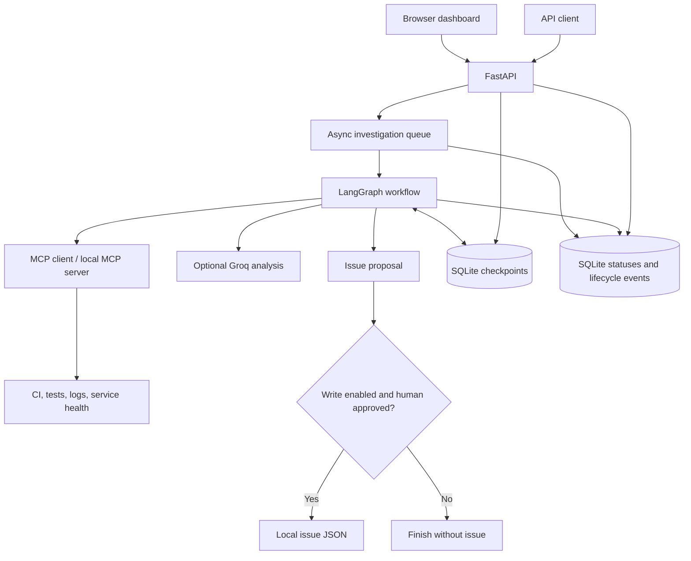

# AI Engineering Operations Agent

A stateful engineering operations agent for investigating CI failures using validated evidence, MCP tools, LangGraph workflows, SQLite persistence, optional LLM analysis, and human approval for write actions.

Built as an incremental **AI engineering and reliability** project: evidence is collected before hypotheses are proposed, and write operations require explicit permission and approval.

**Project status:** Parts 1–16 implemented. The latest locally reported full test run was **106 passed** (November 2026). This result was reported from local pytest execution, not independently verified by a GitHub Actions run. Automated CI is a planned improvement.

## What it does

- Accepts an existing report-run UUID and queues an investigation through FastAPI.
- Uses a custom MCP server to collect CI status, failed tests, application logs, and service health.
- Validates evidence with Pydantic and checks CI run, service, and environment consistency.
- Uses LangGraph for stateful, conditional execution. A passing CI report ends the investigation early; a failed report triggers further evidence collection.
- Handles bounded read-tool timeouts and preserves useful partial evidence when collection fails.
- Optionally generates structured observations, hypotheses, recommended checks, and limitations using Groq.
- Prepares an issue proposal and requires explicit human approval before creating a **local JSON issue record**.
- Persists checkpoints, investigation lifecycle history, timestamps, and node-level execution traces in SQLite.
- Exposes a browser dashboard for starting, reviewing, approving/rejecting, and reopening investigations.

**Not a production incident-remediation service:** evidence sources are local, issue creation is local, and LLM hypotheses are not validated root causes.

## Architecture



### Execution and approval model

For a failed CI run, the graph can execute:

```text
collect_ci
  -> collect_failed_tests
  -> collect_logs
  -> collect_service_status
  -> collect_analysis (optional)
  -> prepare_issue
  -> request_approval (only when issue creation is enabled)
  -> create_issue (only after approval)
```

The approval node can interrupt the graph. After a user approves or rejects, the investigation resumes from its persisted checkpoint. An approval does not bypass server-side permission checks.

## Requirements

- Python **3.12**
- Windows PowerShell for the commands below (the Python code itself is not Windows-specific)
- Dependencies from `requirements.txt`

Runtime components include FastAPI, Uvicorn, Pydantic, LangGraph, the MCP Python SDK, SQLite checkpointing, Groq, and HTTPX.

## Quick start (PowerShell)

### 1. Install

```powershell
git clone https://github.com/oumas3/ai-engineering-ops-agent.git
cd ai-engineering-ops-agent

py -3.12 -m venv .venv
.\.venv\Scripts\Activate.ps1
python -m pip install -r requirements.txt
$env:PYTHONPATH = "src"
```

### 2. Create a local demonstration report run

The API only accepts report-run IDs that already exist under `runtime/runs/<run-id-without-hyphens>/`. Generated runtime data is not committed to Git.

The repository contains sample evidence in `data/`. Copy it into a new run directory:

```powershell
$runId = [guid]::NewGuid().ToString("N")
$runDir = "runtime/runs/$runId"
New-Item -ItemType Directory -Force -Path $runDir | Out-Null
Copy-Item "data/*.json" $runDir

# The investigation executor uses the 'local' environment.
# Align the copied service-health fixture for a consistent demo.
$healthPath = "$runDir/service_status.json"
$health = Get-Content $healthPath -Raw | ConvertFrom-Json
$health.environment = "local"
$health | ConvertTo-Json -Depth 5 | Set-Content $healthPath

Write-Host "Demo report run: $runId"
```

The bundled CI example is a failed backend run, so it exercises evidence collection and proposal generation. Keep the printed `$runId` for the next step.

### 3. Start FastAPI and open the dashboard

```powershell
$env:PYTHONPATH = "src"
python -m uvicorn ops_agent.api:create_app --factory --reload
```

Open:

- **Dashboard:** http://127.0.0.1:8000/
- **API documentation:** http://127.0.0.1:8000/docs

Paste your newly generated report-run ID into the dashboard and select **Start investigation**. Optional AI analysis is disabled by default.

Or submit it through PowerShell in a second terminal:

```powershell
$body = @{ report_run = $runId; analyse = $false } | ConvertTo-Json
Invoke-RestMethod -Method Post -Uri "http://127.0.0.1:8000/investigations" -ContentType "application/json" -Body $body
```

If you open a new terminal, define `$runId` again using the ID printed earlier.

The POST returns HTTP **202 Accepted** and an `investigation_id`. The investigation runs asynchronously; its results become available through the API and dashboard as execution progresses.

### Optional: enable AI analysis

Set `GROQ_API_KEY` in the environment before starting the server, then submit an investigation with `analyse` set to `true`.

```powershell
$env:GROQ_API_KEY = "<your-key>"
```

Do not commit API keys or local `.env` files. If `analyse=true` is requested without a configured Groq key, the API rejects the request.

### Optional: enable issue creation

Issue creation is **disabled by default**. To enable the approval path, set the flag before starting FastAPI:

```powershell
$env:OPS_ALLOW_CREATE_ISSUE = "1"
```

A failed CI investigation with a proposal can then pause for human approval. Approval or rejection is submitted from the dashboard or through `POST /investigations/{investigation_id}/decision`.

Approved issues are written only to `runtime/issues/` as local JSON records. The agent does **not** automatically create GitHub Issues, apply patches, or deploy fixes.

## HTTP API

| Method | Endpoint | Purpose |
|---|---|---|
| `POST` | `/investigations` | Queue a new investigation; returns `202` and its UUID |
| `GET` | `/investigations?limit=20` | List recent investigations; validated limit 1–100 |
| `GET` | `/investigations/{id}` | Retrieve the latest persisted evidence snapshot |
| `GET` | `/investigations/{id}/status` | Read current lifecycle status |
| `GET` | `/investigations/{id}/events` | Read timestamped lifecycle events in order |
| `GET` | `/investigations/{id}/metrics` | Read calculated execution duration |
| `GET` | `/investigations/{id}/traces` | Read node executions and durations |
| `GET` | `/investigations/{id}/approval` | Check whether approval is pending and enabled |
| `POST` | `/investigations/{id}/decision` | Approve or reject a pending write decision |
| `GET` | `/` | Browser dashboard |

An investigation's lifecycle status is one of `queued`, `running`, `awaiting_approval`, `completed`, or `failed`.

### Observability

The dashboard displays investigation history, lifecycle progress, timestamped events, execution duration, and a node execution trace table.

Each node trace contains:

- Node name and investigation UUID
- Outcome: `completed`, `failed`, or `interrupted`
- Start timestamp and duration in milliseconds
- Exception type when applicable, without exposing exception-message contents

Execution duration is calculated from the `running` lifecycle event to the first terminal/approval event; it **excludes time waiting for human approval**. Node traces record individual node execution attempts, including interrupted and resumed attempts.

Older investigations created before event tracing may have empty event or trace histories.

## Persistence and local files

| Path | Purpose |
|---|---|
| `data/` | Tracked sample engineering evidence |
| `runtime/runs/<run-id>/` | Local report-run input files |
| `runtime/checkpoints.sqlite` | Persisted LangGraph checkpoints |
| `runtime/investigation_statuses.sqlite` | Investigation statuses, lifecycle events, and node traces |
| `runtime/issues/` | Locally created, approved issue records |
| `src/ops_agent/workflow.py` | LangGraph graph construction and routing |
| `src/ops_agent/nodes.py` | Evidence, analysis, approval, and write nodes |
| `src/ops_agent/mcp_server.py` | Custom MCP tool server |
| `src/ops_agent/api.py` | FastAPI routes and lifecycle |
| `src/ops_agent/api_runner.py` | Queued investigation worker |
| `src/ops_agent/api_executor.py` | Graph invocation and checkpoint management |
| `src/ops_agent/api_decisions.py` | Approval checks and graph resumption |
| `src/ops_agent/api_status_store.py` | SQLite status, event, and trace persistence |
| `src/ops_agent/node_tracing.py` | Node timing and failure/interrupt tracing |
| `src/ops_agent/observability.py` | Execution-duration calculations |
| `src/ops_agent/web/index.html` | Browser dashboard |
| `tests/` | Automated tests |

The `runtime/` directory and `.env` files are ignored by Git.

## Testing

Activate the environment and run:

```powershell
$env:PYTHONPATH = "src"
python -m pytest -q --basetemp=.\.pytest-tmp-all
git diff --check
```

**Last reported local result: 106 passed (November 2026).** This is a development baseline, not a claim that GitHub CI has executed the suite.

Tests cover validation, MCP integration, conditional routing, read-tool timeouts, SQLite checkpointing, approval and issue-creation safeguards, HTTP responses, lifecycle events, duration calculations, node tracing, interrupts, resumption, and trace-storage failures.

## Design and safety principles

1. **Validate at boundaries.** Pydantic checks the structure of external evidence, and the workflow verifies matching run/service/environment identifiers.
2. **Separate evidence from inference.** AI hypotheses and recommended checks are labelled as unverified.
3. **Preserve partial evidence.** An unavailable tool should not discard evidence from successful sources.
4. **Require explicit approval for writes.** Issue creation requires server permission, a proposal, and a human decision.
5. **Observe without deciding.** Trace-storage failures are logged rather than used to change a node's decision.

This project is intended for **local development and evaluation**. The API does not currently implement production-grade authentication or remote issue-tracker integration. Do not expose its write-enabled interface directly to the public internet.

## Development roadmap

| Milestone | Status |
|---|---|
| Parts 1–11: evidence collection, MCP, LangGraph, persistence, approval, LLM analysis | Complete |
| Part 12: asynchronous FastAPI interface | Complete |
| Part 12B: browser dashboard | Complete |
| Part 13: investigation lifecycle status tracking | Complete |
| Part 14: investigation history and reopening results | Complete |
| Part 15: lifecycle observability and duration metrics | Complete |
| Part 16: LangGraph node-level tracing | Complete |
| Part 17: project quality, documentation, and automated CI | Planned |
| Part 18: agent evaluation and regression scenarios | Planned |

## Current limitations

- Inputs and issue outputs are local rather than connected to production CI or issue trackers.
- The evidence-gathering workflow is predefined; dynamic model-driven tool planning is not implemented.
- LLM analysis is optional and should not be treated as verified root cause.
- Dependency versions are not fully locked for reproducible installs.
- CI automation and systematic agent evaluation are future work.
- Cancellation is currently recorded as a failed node with `CancelledError`, and stopping an async wrapper cannot forcibly stop synchronous work already running in a thread.
- Node-trace persistence is best-effort; a successful node can still complete if its trace could not be saved.

## Development workflow

Features are developed in dedicated branches, tested locally, and proposed through pull requests into `master`. The next engineering priorities are **automated CI checks, repository cleanup, and repeatable agent-evaluation scenarios**.
